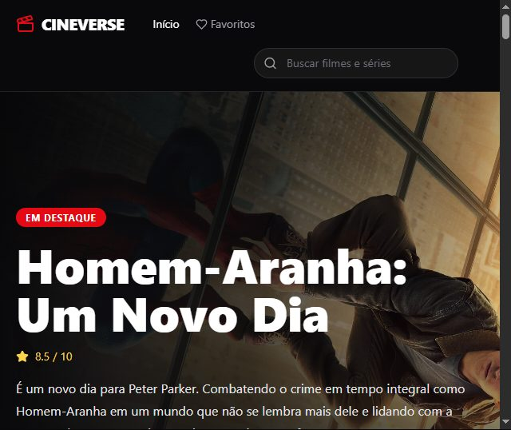
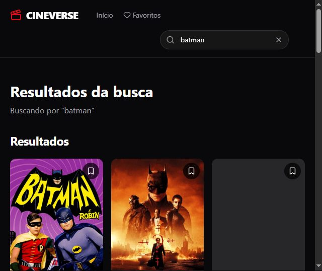
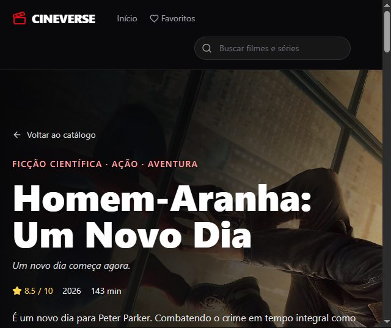
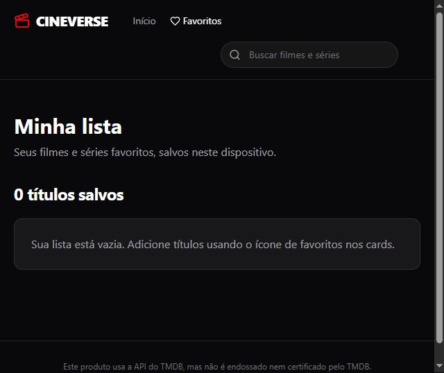

# CineVerse

O CineVerse é uma aplicação web para descobrir filmes e séries. O catálogo reúne títulos populares, tendências da semana, produções mais bem avaliadas e lançamentos futuros. Também é possível pesquisar, consultar informações sobre cada título e guardar favoritos para acessar depois.

Os dados de filmes e séries são obtidos da API do [The Movie Database (TMDB)](https://www.themoviedb.org/). A interface está em português do Brasil e foi desenvolvida para funcionar em diferentes tamanhos de tela.

## Acesse o projeto

O CineVerse está publicado no Vercel: [cine-verse-omega-nine.vercel.app](https://cine-verse-omega-nine.vercel.app/).

## Demonstração

Capturas de algumas páginas do projeto:

<p align="center">
  
  
</p>
<p align="center">
  
  
</p>

## Funcionalidades

- Página inicial com destaques, tendências, títulos mais bem avaliados e próximos lançamentos.
- Busca de filmes e séries, com paginação dos resultados.
- Página de detalhes com sinopse, gêneros, avaliação, elenco, recomendações e trailer quando disponível.
- Lista de favoritos salva no armazenamento local do navegador (`localStorage`).
- Estados de carregamento e mensagens de erro para as consultas à API.

## Tecnologias

- React 18 e TypeScript
- Vite
- Tailwind CSS
- React Router
- Lucide React para ícones
- API do TMDB para catálogo, imagens e informações dos títulos

## Como executar

### Pré-requisitos

- Node.js e npm instalados.
- Uma conta no TMDB e um **API Read Access Token**. Você pode gerar o token nas configurações de API da sua conta.

### Configuração

1. Clone ou baixe este repositório e abra a pasta do projeto no terminal.
2. Na raiz do projeto, crie um arquivo `.env` com o token de leitura do TMDB:

   ```env
   TMDB_READ_ACCESS_TOKEN=seu_token_de_leitura
   ```

3. Instale as dependências e inicie o servidor de desenvolvimento:

   ```bash
   npm install
   npm run dev
   ```

4. Abra no navegador o endereço local informado pelo Vite.

## Rotas

| Rota | Conteúdo |
| --- | --- |
| `/` | Página inicial e catálogo |
| `/search?q=termo` | Resultados da busca |
| `/movie/:id` | Detalhes de um filme |
| `/tv/:id` | Detalhes de uma série |
| `/favorites` | Lista de favoritos salva neste navegador |

## Estrutura do projeto

```text
src/
  components/   Componentes da interface, como cabeçalho, busca e cards
  context/      Estado compartilhado dos favoritos
  hooks/        Hooks reutilizáveis, incluindo debounce da busca
  pages/        Páginas inicial, de busca, detalhes e favoritos
  services/     Comunicação com a API do TMDB
  types/        Tipos TypeScript dos dados
  utils/        Funções auxiliares para títulos, notas e imagens
```

## Uso de inteligência artificial

Este projeto foi criado com a ajuda de inteligência artificial, utilizando o **Microsoft Copilot** como ferramenta de apoio durante o desenvolvimento. O Copilot auxiliou na implementação e no aprimoramento do projeto; seu uso não substitui a revisão e a responsabilidade sobre o código final.

## Autor

**Luiz Junior Pinheiro de Almeida**

## Créditos

As informações, imagens e vídeos de filmes e séries são fornecidos pelo TMDB. Este produto usa a API do TMDB, mas não é endossado nem certificado pelo TMDB.
